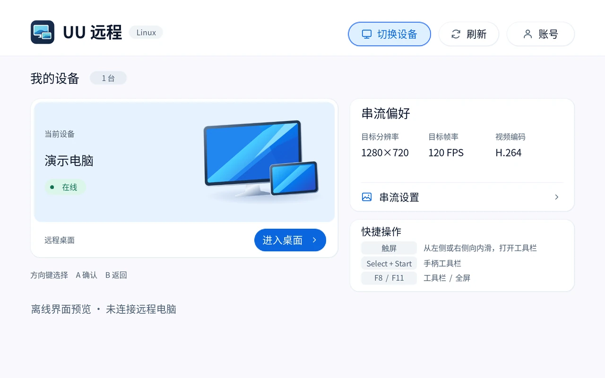

# YOUYOU 远程 Linux 版

在运行 Ubuntu 26.04 ARM64 和 KDE Plasma 的联想 Y700 上，用触屏或拯救者 G9 手柄串流 Windows 桌面。电脑端使用官方 UU 远程，与平板登录同一账号。

## 感谢两位 Switch 客户端作者

- 感谢 **Antman2023** 开发最初的 Switch 原生客户端，打通扫码和短信登录、设备列表、WebRTC 音视频与手柄输入，让自制客户端能直接连接原版 Windows 电脑端。[UURemote-ns](https://github.com/Antman2023/UURemote-ns)
- 感谢 **doke69** 在这个基础上改进设备首页和串流菜单，扩展 H.265 播放、手柄与多点触控、画质设置和网络诊断。Y700 的设备卡与手柄导航由这套界面移植而来。本项目使用其 0.3.74 Beta 代码作为直接上游。[YOUYOU-Remote-ns](https://github.com/doke69/YOUYOU-Remote-ns/blob/ba4d7f9f8f87f4a47e4d872db3dd0ca526718f8b/README.md) · [上游致谢](https://github.com/doke69/YOUYOU-Remote-ns/blob/ba4d7f9f8f87f4a47e4d872db3dd0ca526718f8b/docs/credits.md)

## v0.2 重写（开发中，未发布）

> 本节之后的「安装与登录」到「许可与资源」描述的仍是已发布的 v0.1.15。v0.2 做完前不发版，旧代码也先不删。

v0.1.15 把上游的 Switch 程序整个移植成一个 Linux 程序，再在里面补 Linux 的显示和输入，层次混在一起，画面要回 CPU 转格式，指针也跟手慢。v0.2 只保留上游的协议核心，播放器、界面、输入、打包都重写。

### 结构

| 路径 | 是什么 |
| --- | --- |
| `core/upstream/` | doke69/YOUYOU-Remote-ns v0.3.74-beta（`ba4d7f9`）的 git subtree。只做最小的 Linux 适配和下面「实现要点」里的功能补丁，补丁处都有注释；同步上游用 `git subtree pull`，冲突按注释合。依赖由它自己的 `scripts/fetch_deps.py` 和 `patch_deps.py` 按哈希拉取、打补丁。 |
| `core/upstream/include/stream_limits.hpp` | 补丁新增：允许的帧率（30/60/120/144/164）和串流尺寸（偶数，最大 4096×2160），以及按尺寸和帧率算 SDP 的 H.264/H.265 level。 |
| `core/CMakeLists.txt` | 把上游的登录、信令、WebRTC 和 Opus 音频，加上下面两个文件，编成 `libyouyou_core.so`。`youyou_core.map` 让它只导出 `yy_*`。 |
| `core/bridge.h`、`bridge.cpp` | 给 Rust 用的 C 接口：`yy_open/close`、`yy_command`（直接转给上游 `Client::command`）、`yy_snapshot`（JSON 状态）、`yy_frame_acquire/release/wait`，以及自测用的 `yy_debug_video`。 |
| `core/media_linux.cpp` | Linux 媒体层：把收到的访问单元直接送进 V4L2 有状态解码器（高通 iris），用 `VIDIOC_EXPBUF` 把解出的 NV12 缓冲作为 DMA-BUF 借给播放器。CPU 不碰像素。 |
| `core/tests/decode_test.cpp` | 解码自测：整段、重置后、从 GOP 中间开始，三种情况都要出画面。 |
| `core/tests/protocol_test.cpp` | 协议补丁自测（无依赖，断言）：帧率档位、尺寸校验、屏幕列表解析（含显示缩放，打包 / 不打包 / 截断三种）、虚拟屏尺寸请求的参数校验、缩放请求的字段 9。 |
| `app/` | Rust 播放器 `youyou`（独立的 Cargo 工程，旧的根 workspace 删掉后再并回）。 |
| `app/src/bridge.rs` | C 接口的封装。`Core` 拿着账号锁，drop 时先 `yy_close` 再放锁；`Frame` drop 时关 fd 并还缓冲。 |
| `app/src/video.rs` | 零拷贝显示：每个解码缓冲导入成两张 EGLImage（亮度 R8、色度 GR88），着色器里做 YUV→RGB；`fit` 算黑边。 |
| `app/src/input.rs` | 触屏、鼠标、键盘、手柄到 UU 输入协议的映射（来自 v0.1.15，已审过，3 个单测）。 |
| `app/src/clip.rs` | `youyou play` 用：把 Annex-B 文件切成访问单元。 |
| `app/src/main.rs` | 命令行入口；`Screen`（SDL 窗口、GL 上下文、手柄，大厅和串流共用一个窗口）；`stream()` 串流循环：转发输入、边缘侧滑 / Select+Start / F8 开菜单、轮询状态、连接中面板；`Prefs`（`app.ini`）；统计。 |
| `app/src/ui.rs` | 即时模式界面库，和 `video::Renderer` 共用一个 GL 上下文：圆角矩形（SDF 着色器）、文字（ab_glyph，字体用 `fc-match` 找 Noto Sans CJK）、图标（resvg 把 SVG 栅格化成纹理）、二维码、按钮、选项片、输入框、补间动画。尺寸单位是 Android 的 dp（见「实现要点」）。 |
| `app/src/lobby.rs` | 不在串流时的全部页面：下载签名材料、扫码登录、短信登录、电脑列表、设置、自定义尺寸、账号（退出登录要点两次）。返回要连的电脑或退出。 |
| `app/src/menu.rs` | 串流时盖在画面上的东西：侧边抽屉（触屏模式、专用桌面的缩放、电脑屏幕的防窥模式、继续、断开），以及连接中 / 重连中的面板。 |
| `assets/icons/*.svg` | 界面图标，编进程序里（`ui.rs` 的 `ICONS`）。`assets/youyou-mark-192.rgba` 是登录页和首页的标志。 |
| `account/` | 账号材料（APK 提取签名、client-id、单实例锁），v0.2 直接复用。 |
| `tools/` | 测量工具，结果在 `tools/results/`：<br>• `decbench.c`、`v4l2bench.c`：解码延迟对比。<br>• `pacing-run.sh`：本地片段的上屏节奏。跑完把面板切回原来的模式。<br>• `desktop-run.py` + `stream-run.sh`：真网络专用桌面测量。电脑端跑前者，它在平板上启动后者；电脑的物理显示器亮着就行，测试页只开在虚拟屏上。原始输出在 `tools/results/runs/`，不进 git。 |

根目录的 `src/`、`native/`、`player/`、`build.rs`、`Cargo.toml`、`packaging/`、`integrations/` 是 v0.1.15，只留作对照，v0.2 做完后删除。`player/src/input.rs` 已经移到 `app/`，所以这棵旧树在 main 上编不过；要构建 v0.1.15，用 tag `v0.1.15`。

### 现在能做什么

```sh
youyou                          # 打开界面：登录、选电脑、设置、串流
youyou devices                  # 用已保存的登录列出电脑
youyou connect [电脑名或设备 ID]  # 跳过首页直接全屏串流
youyou play clip.hevc [帧率]     # 不联网：解码并全屏显示一段 H.264/HEVC，打印统计
```

界面：

- **登录**：第一次打开先下载签名材料，然后扫码（官方 UU 远程 App 扫）或短信验证码。
- **首页**：账号下的电脑，在线的能点；可以刷新列表、进串流设置。
- **设置**：分辨率（面板原生、75 %、50 %、1080p、1440p、自定义）、帧率（30/60/120/144/164）、编码、码率上限、专用桌面、触屏模式。前四项是上游的画质设置，存在 `config.ini`；后两项存在 `app.ini`。
- **串流中**：没有角落按钮。从屏幕左边或右边往里划、手柄 Select+Start、或键盘 F8 打开侧边菜单；点菜单外面、手柄 B、Esc 关上。菜单里能切触屏模式、改专用桌面的缩放（电脑给的档位，常见 100 %～225 %）、切电脑屏幕的防窥模式（正常显示 / 隐私屏保 / 关闭显示屏）、断开。

环境变量：

- `YY_VSYNC=1` 开垂直同步（默认关）。
- `YY_TOUCH=mouse|touch`、`YY_DESKTOP=1|0` 临时盖过界面里的设置。
- `connect` 时 `YY_STREAM=2280x1428@120`、`YY_MBPS=60` 临时改串流尺寸、帧率和码率上限（连接前存进 `config.ini`）。

注意 `config.ini` 和 v0.1.15 共用，界面里的设置和 `YY_STREAM`、`YY_MBPS` 都会改写它。

### 在 Y700 上构建

```sh
# 一次：sudo apt install build-essential cmake ninja-build pkg-config python3 cargo rustc libsdl2-dev libopus-dev libcurl4-openssl-dev libegl-dev libgles-dev
(cd core/upstream && python3 -I scripts/fetch_deps.py && python3 -I scripts/patch_deps.py)
cmake -S core -B build -G Ninja -DCMAKE_BUILD_TYPE=Release -DYY_TESTS=ON
cmake --build build
(cd app && YY_CORE_LIB_DIR=../build cargo build --release && cp ../build/libyouyou_core.so target/release/)
(cd app && LD_LIBRARY_PATH=../build cargo test --release)
```

`youyou` 通过 rpath `$ORIGIN` 找同目录的 `libyouyou_core.so`。

### 实现要点

- **解码**：直接用 V4L2，不走 FFmpeg 或 VA-API。同样的片子，从送进去到能显示（p50）：HEVC 2560×1600 4.5 ms 对 VA-API 12.1 ms，HEVC 1080p 3.7 对 7.6（`tools/results/20261102-decode-latency.txt`）。丢包或积压时跟上游一样，丢到下一个随机访问点并请求关键帧。HEVC 的 CRA 也算随机访问点，因为 x265 的周期关键帧就是 CRA。
- **交给播放器**：只留最新的一帧。播放器没来得及取的帧直接还给解码器。节奏由播放器管，因为只有它知道屏幕什么时候刷新。`yy_frame_wait` 让播放器的唤醒线程睡到有新帧为止，不轮询。
- **显示**：解码缓冲按缓冲号导入一次，之后复用；解码器重新初始化（`epoch` 变了）时全部释放。导入**必须**带显式的 `DRM_FORMAT_MOD_LINEAR` modifier，原因见下面「踩过的坑」。颜色矩阵在自己的着色器里做（BT.709 有限范围），不依赖驱动的 YUV 采样。
- **输入**：指针移动在一轮事件里合并成一次，按键、按钮、滚轮之前先发掉，所以不会积压。上游把输入放进队列，工作线程最多等 4 ms。协议里只有绝对坐标（`mouse_move_absolute`），没有相对鼠标。
- **高帧率**（补丁，审自 v0.1.15 的 high_fps）：`gv_pb.FPS` 最高只到 144 档（4）。120、144、164 都用 4 档，确切帧率放在 `CaptureParams.fpsCount`（连接时字段 11，RPC 字段 18）。电脑回报的只有档位，所以回报 4 档只能证明是 144。帧率专用的 `FpsSettingRequest` 只有枚举，所以改到 120/164 要重连。
- **任意尺寸**（补丁，审自 v0.1.15 的 custom_resolution）：偶数宽高、最大 4096×2160 都放行。不是 720p/1080p 时，能力 JSON 里带上自定义尺寸。SDP 的 level 按亮度采样率算（1080p、120 帧以内保持原来的报价）。
- **专用桌面**（补丁）：连接选项字段 1 填 6（`CT_SECOND_SCREEN`）而不是 1（`CT_DESKTOP`），字段 9 填本机设备 ID。电脑会为这次会话新建一块虚拟屏，并按客户端记住它的尺寸和位置。
- **虚拟屏尺寸**（补丁，审自 v0.1.15 virtual_display 的 Initialize）：电脑按记住的尺寸建屏，不看这次请求的尺寸。所以专用桌面会话收到屏幕列表后，如果当前屏是虚拟屏（类型 1）、尺寸不对、而它的模式列表里有串流尺寸，就发一次「选屏 + 桌面尺寸 + 编码尺寸」（方法 2）。电脑应答后会改虚拟屏，也会记住新尺寸。发过之后，本会话不再发上游的视频缩放请求（原因见「踩过的坑」）。
- **退出时断开**：上游的 `Client` 析构时不通知电脑断开，电脑会一直显示「被控制中」，直到心跳超时。播放器退出前先发 `disconnect`，等 `activeDeviceId` 清空（上游断开的最后一步），最多 3 秒。
- **界面尺寸按 Android 的 dp 算**：1 dp = 1/160 英寸，Y700 是 8.8 英寸 3040×1904，约 408 ppi，所以 1 dp = 2.55 像素，整屏约 1192×747 dp，页面在玻璃上和官方安卓 App 一样大。KDE 自己的缩放是 1.9，照它画的话 16 号字只有 1.9 mm 高，在平板上看不清。合成器报的屏幕物理尺寸是错的（168×268 mm，等于 12.4 英寸），运行时算不出真实密度，所以 `ui.rs` 里写死 `PANEL_PPI = 408`。换别的设备要改这个数；比合成器缩放还小时取合成器的。
- **界面是即时模式**：每帧从状态重画整页，不存控件树。没动静时不画：事件循环在没事件、没动画时睡 250 ms（只为轮询上游状态），有补间动画时 8 ms 一帧。串流中只有菜单或面板开着才画界面层，画面本身照常按新帧上屏，打开菜单不卡画面（实测 379 帧跳 1 帧）。
- **串流中的菜单**：从左右边缘 24 dp 内按下、往里划 40 dp 才算开菜单，起点附近的触摸不发给电脑。打开菜单时先松开电脑上所有按着的触点、键和手柄（本地 + 上游的 `release`），避免卡键。断开走上游 `disconnect`，回到首页。
- **防窥模式**：上游的 `privacy-screen` 命令（1 正常显示、2 隐私屏保、3 关闭显示屏），只在串流中、设备 ID 对得上时有效。等电脑应答期间，选项片显示请求的模式；应答后显示 `mode`。电脑拒绝时菜单里显示原因，例如错误 508「电脑未完成屏幕保护设置」：要先在 Windows 里设好屏幕保护程序，隐私屏保才能开，这是电脑那边的事。
- **专用桌面的缩放**（补丁，2026-11-02）：
  - 屏幕列表里每块屏带一个 `DpiScale`（`Screen` 字段 9：1 当前、2 推荐、3 可选档位，百分数，档位可能打包也可能不打包）。`quality_rpc.cpp` 解析它，`client.cpp` 放进快照的 `desktopScale`。
  - 改缩放就是再发一次画质更新，`CaptureSettingRequest` 多带字段 9 `dpi_scale`。电脑应答后在 `CaptureSettingSync` 字段 8 回报新值；出错时菜单显示错误码，选项片回到当前值。
  - 只在当前屏是虚拟屏（类型 1）时出现。在物理屏上它改的是电脑自己显示器的缩放，会弄乱坐在电脑前的人的桌面。
  - 电脑会按客户端记住虚拟屏的缩放（实测：设成 200 % 后断开重连还是 200 %），所以平板不另存，也不在连接时主动发。
  - 2280×1428 的虚拟屏默认 100 %，在 8.8 英寸上字太小；电脑给的档位是 100/125/150/175/200/225。
- **垂直同步默认关**（`tools/results/20261102-pacing.txt`）：开和关上屏节奏完全一样，因为 KWin 总是在 vblank 翻页。面板 120 Hz 时，开着会让每帧晚一个刷新才离开播放器：出解码器→交换完成 11.8 ms，关着是 0.5 ms。SDL2 2.32 没实现 Wayland 的撕裂协议，所以关了也不撕裂。

### 实测（Y700，HEVC 2560×1600，120 帧，本地片段）

| 面板 | 一帧一刷 | 一帧停两刷 | 1 % low |
| --- | --- | --- | --- |
| 164 Hz | 63.4 % | 36.6 %（每秒 44 次，均匀分布） | 75–82 fps |
| 120 Hz | 99.9 % | 0.06–0.11 % | 107–113 fps |

164 不是 120 的整数倍，所以在 164 Hz 面板上放 120 帧必然一抖一抖。这跟播放器无关，换什么播放器都一样。要顺，面板刷新率必须是串流帧率的整数倍：120 帧配 120 Hz，144 帧配 144 Hz。

### 实测（真网络，Wi-Fi 连 Windows 电脑，面板 120 Hz，还没加帧节奏器）

`tools/results/20261102-network.txt`，各只有一次 30 秒的样本，只能看个大概：

| 实际串流 | 一帧一刷 | 1 % low | 解码 |
| --- | --- | --- | --- |
| HEVC 2560×1440，120 帧，专用桌面 | 95.75 % | 37.4 fps | 4.5 ms，119.5 fps，0 丢 |
| HEVC 1920×1080，120 帧，专用桌面 | 98.70 % | 42.9 fps | 2.4 ms |
| HEVC 2280×1428，120 帧，专用桌面（n1） | 99.52 % | 64.6 fps | 3.6 ms，0 丢 |
| HEVC 2280×1428，120 帧，专用桌面（n2，隔两分钟） | 95.92 % | 56.7 fps | 3.5 ms，0 丢 |

- 本地片段是 99.9 %，剩下那几个百分点出在网络和时钟上。电脑端测试页两次都很稳（每秒约 480 帧，最大间隔 2.3 ms）。
- n1 和 n2 一样的程序、一样的设置，差了 3.6 个百分点。看 `ml-flips.py` 的相位列：n1 每帧在上次翻页后约 3 ms 出解码器，n2 约 5.8 ms，而且 30 秒里基本不动（电脑和面板的时钟几乎同步）。5.8 ms 正好卡在 KWin 决定下一刷放哪帧的时间点上，一点网络抖动就让帧在「赶上」和「迟到」之间来回跳：先重复一刷，再一刷来两帧、丢一帧。相位落在哪是每次会话的运气，不是播放器慢（出解码器到交换完成 0.4–0.5 ms）。n2 第 3–5 秒另有一阵网络抖动。
- 这两种情况都是帧节奏器管的：手里压一帧，在每个刷新周期的固定时间点交出去，代价是多约一个刷新（8.3 ms）的延迟。Moonlight 在同一台平板上加了以后从 91 % 升到 99.67 %。要不要加，用多次 A/B 决定。
- 电脑对 60 Mbps 的码率上限回报「已应用 100 Mbps」（d1、n1、n2 都是），原因还没查。
- 第二行原本要的是 2280×1428。由于下面「踩过的坑」里两个请求打架，电脑最后给了 1080p；修好以后，那次测试没能跑完。

### 踩过的坑（根因）

- **EGL 导入报 `EGL_BAD_ALLOC`**（Mesa 26 freedreno，Adreno 840）：
  - 不带 modifier（即 `DRM_FORMAT_MOD_INVALID`）时，按单张 NV12 导入或按 R8/GR88 分平面导入都会被拒。
  - 显式传 `EGL_DMA_BUF_PLANE0_MODIFIER_LO/HI_EXT = 0`（LINEAR）就好了。
  - 按单张 NV12 导入还有第二个问题：Mesa 会把它拆成 `r8_g8b8_420` 两个平面，960×540 的色度平面被拒。所以用两张图。
  - 导出时用 `O_RDONLY` 就够了，`O_RDWR` 试过，不是原因。
- **退出时 abort（`std::system_error: Invalid argument`）**：静态的 `uu::Media` 和帧槽在 `exit()` 析构时，别的线程还在用它们。两者都改成故意不析构（`*new`）。
- **iris 的可见尺寸**：要在 `S_FMT` 之前读 CAPTURE 的 crop。之后 iris 会把 crop 重置成编码尺寸（1080 变 1088）。
- **自测片段有 B 帧**：x264 的 `-preset fast` 会加 B 帧，播放器看到的帧序就不是显示序，统计成跳帧 25 %。测试片要加 `-bf 0`。真实串流没有 B 帧。
- **测试脚本发 SIGINT，播放器没反应**：bash 会让后台任务忽略 SIGINT，SDL 看到「已忽略」就不装处理函数。结果统计没打印、也没发断开，最后被 SIGKILL。要让播放器正常退出，用 SIGTERM。
- **请求 2560×1600，收到的是 2560×1440**：电脑按客户端记住的尺寸建虚拟屏（当时是 2280×1428），然后把编码套到最近的标准档位，宽高比也变了。解决办法是上面的「虚拟屏尺寸」请求。这次请求还让电脑把记住的尺寸改成了 2560×1440，下一次会话就按这个建屏。
- **虚拟屏改好后又被改回去**（2026-11-02，d3）：上游的视频缩放请求在字段 5/6 填的是当时观察到的画面尺寸（旧的 2560×1440）。它和桌面尺寸请求几乎同时发出，电脑先改成 2280×1428，又被它改回 2560×1440，编码最后落在 1920×1080。所以发过桌面尺寸请求的会话，不再发视频缩放请求。
- **串流时电脑的物理显示器关不掉**（测试环境的限制，不影响使用；2026-11-02 起测试时物理屏亮着测，不再关）：
  - GameViewer 在连接时、串流中约每半秒就请求一次「显示器保持亮」。
  - 强行熄屏，Windows 就不再合成任何屏幕（包括虚拟屏），串流掉到个位数帧。
  - 把物理屏从显示布局里摘掉，GameViewer 约 1 秒内会按它记住的布局重新启用它们。
  - 所以在 Windows 电脑上测专用桌面，只能让物理显示器亮着，或者按显示器自己的电源键关掉。
- **贴着屏幕边缘划不开菜单**：KWin 自己的边缘手势会吃掉起点离屏幕边约 6 个逻辑像素以内的触摸，程序收不到。离边 16 个逻辑像素起划就能开。要真正贴边划，得接 y700-edge（第 7 步）。
- **字太小**（2026-11-02 真机反馈）：一开始按 SDL 窗口单位（= KDE 的 1.9 缩放）排版，以为是 12 英寸屏。改成按 dp 排版，见「实现要点」。

### 有意不做 / 暂时偷懒

- **播放器不自己切屏幕刷新率**：Wayland 没有让普通程序改显示模式的协议。面板配哪个刷新率由系统决定，上面的表说明了该怎么配。Y700 上由 y700 项目的刷新率守护来管，不写进这里，因为本项目不放个人定制。
- **只按 BT.709 有限范围转色**：UU 主机发的就是这个。哪天主机发别的，再读码流的 VUI（V4L2 colorspace）。
- **没有相对鼠标**：协议里没有。
- **首页不滚动**：一屏放 3 列 × 3 行，最多 9 台电脑。等有人的电脑更多再加（代码里有 `shortcut:` 注释）。
- **没有屏幕键盘**：手机号、验证码、自定义尺寸都用页面里自带的数字键盘输入，这几处只要数字。
- **本地导入 APK / 签名只有命令行**（`import-apk`、`import-key`）：界面里只有下载，导入是给没网或要自己提供材料的人用的，少数情况。
- **AV1 还没搬**：v0.1.15 的 AV1 补丁还没审，设置里的编码只有上游原有的 H.265 和 H.264。
- **启动时的错误只到 stderr**：已有账号材料但打不开（如账号目录权限不是 0700）时，程序不开窗口直接退出，原因打在终端或 journal 里。第一次下载材料后打不开的，页面上会显示「准备失败」。桌面启动项做好（第 7 步）后再考虑弹窗。
- **`PANEL_PPI` 写死成 Y700**：原因见「实现要点」。本项目只针对 Y700。
- **没搬 v0.1.15 的整套虚拟屏状态机**（会话中新建、切换、移除虚拟屏，以及 `encoderBounds` 放宽编码档位）：「连成专用桌面、桌面就是串流尺寸」只需要上面那一个请求。做界面时如果要选屏，再按需搬。
- **帧率回报只到档位**：120 和 164 的「已应用」帧率显示为未知，因为电脑只回 4 档（等于 144）。

### 进度

- [x] 1. 上游原样在 Linux 上编通（subtree + 自己的 CMake）
- [x] 2. 核心库 C 接口 + V4L2 零拷贝媒体层，解码自测
- [x] 3. 审 v0.1.15 的补丁，只当参考
- [x] 4. Rust 播放器：零拷贝上屏、颜色校验、节奏实测
- [ ] 5. 真网络：连电脑，和 v0.1.15、Moonlight 用同一把尺子（`ml-flips.py`）比；看要不要像 Moonlight 那样加帧节奏器和 CPU 下限（uclamp.min）
  - [x] 高帧率、任意尺寸、专用桌面、虚拟屏尺寸四个补丁，真机连通（2560×1440 和 2280×1428 都收到过 120 帧）
  - [x] 2280×1428@120 完整测两轮（99.52 %、95.92 %，差别来自相位，见「实测」）
  - [ ] 帧节奏器、uclamp 的 A/B；对比 v0.1.15、Moonlight
- [x] 6. 界面：扫码/短信登录、设备页、串流菜单、设置（编码、分辨率、帧率、码率、虚拟屏、防窥）
  - [x] 平板上截图逐页看过：下载、扫码、短信、首页、设置、自定义尺寸（非法尺寸标红）、账号（退出只点到第一下）、`play` 时左右两侧的抽屉。做法：以桌面用户身份用 `systemd-run` 起程序，合成触摸点按，KWin 截图；测前备份 `config.ini`，测完还原。登录页用临时状态目录（`XDG_STATE_HOME`，权限 0700）测，不动真账号。
  - [x] 真连电脑验过：连接中面板、抽屉里的实时统计、防窥请求往返（电脑回 508 时菜单显示原因）、缩放改到 200 % 并在重连后保持、断开回首页
  - [ ] 还没验：手柄导航、F8、防窥的「关闭显示屏」（会关掉电脑的物理屏，没在有人用的电脑上试）
- [ ] 7. 边缘手势接入 y700-edge、deb 打包、删除 v0.1.15 代码、发布前完整 README

## 安装与登录

在 Y700 上下载最新的 `arm64.deb` 安装包，进入只放这一版本安装包的目录后执行安装命令。[下载 ARM64 安装包](https://github.com/bobsixsixsix-boop/YOUYOU-Remote-Linux/releases/latest)

```sh
sudo apt install ./youyou-linux_*_arm64.deb
```

从 KDE 应用菜单打开「YOUYOU 远程」。首次启动选择「从网易官网下载并准备」，或选择已有的官方 UU 远程 TV 3.5.0 APK。客户端在本机提取并校验此版本的请求签名材料。

用手机 UU 远程 App 扫码确认，或选择「短信登录」。在设备列表选择在线电脑，点「进入桌面」。

## 平板操作



| 操作 | 方法 |
| --- | --- |
| 移动焦点、确认、返回 | G9 十字键或左摇杆移动，A 确认，B 返回 |
| 用触屏开关串流工具栏 | 从左边缘向右或从右边缘向左轻扫即可打开。在任何一层，点面板外的串流画面或右上角的 × 即可回到串流；左上角的返回箭头只退一层 |
| 用手柄或键盘开关工具栏 | G9 同时按 Select + Start，或按键盘 F8 |
| 用手指点按、拖动 Windows 桌面 | 在工具栏打开「外设 → 触屏操作 → 桌面鼠标」。手指落下即按下鼠标左键，按住移动即可拖窗口，抬手松开 |
| 切换全屏 | 按 F11 |
| 连接前调整参数 | 首页进入「串流设置」。横屏左栏显示当前配置，右栏调整选项 |
| 切换主机屏幕 | 串流工具栏进入「显示 → 主机显示器」 |
| 创建平板专用桌面 | 「显示 → 平板专用桌面」使用 Windows 端的 UU 虚拟显示驱动。要移除本次创建的屏幕，先切回另一块屏幕 |
| 记住专用桌面的位置 | 在「平板专用桌面」中开启「记忆专用桌面」，主机按客户端身份保存布局，断开后收回屏幕，下次连接时恢复位置。切换此选项会重新连接 |
| 被控端防窥 | 工具栏点「防窥」，可启用隐私屏保、关闭被控显示屏或恢复正常显示。当前主机版本在「记忆专用桌面」模式下拒绝防窥，页面提供「切换普通桌面并重连」入口。切换会关闭专用桌面，窗口可能移动。当前状态以电脑回报为准 |

如果 Y700 桌面安装了 `y700-edge` 系统返回手势，在平板的 KDE 会话里用当前用户运行一次：

```sh
youyou-enable-y700-gestures
```

设置后，前台串流窗口接管左右边缘，手指可以从屏幕外直接划进来。回到设备首页、切换应用或关闭客户端后，系统边缘返回自动恢复。若要撤销这次设置，运行 `youyou-enable-y700-gestures --restore`。

触屏模式的选择会保存在平板上。默认的「原生多点触控」适合使用双指缩放等 Windows 触屏手势；切换到「桌面鼠标」后，单指直接定位指针，边缘侧滑仍打开本地工具栏。

## 画面与带宽

- **分辨率。** 可按平板比例选择短边 720、1080、1440 或原生宽高的 50%、75%、100%，也可选择常用 16∶9 档或自定义宽高。3040 × 1904 屏幕的 1080 档请求 1724 × 1080，50% 请求 1520 × 952。连接后，尺寸页分别显示桌面尺寸、串流目标与实际收到的画面。主机可能采用相邻档位。
- **帧率与码率。** 帧率上限可选 30、60、120、144 或 164 FPS，实际帧率受主机屏幕刷新率、编码能力和网络限制。目前实测的 UU 虚拟屏最高为 144 Hz，选择 164 FPS 时主机仍按 144 FPS 输出。客户端垂直同步默认关闭。带宽紧张时，可在「画面设置 → 码率上限」选择 5 至 100 Mbps 的预设档。实际带宽还包括声音、传输开销和重传。
- **编码。** 支持 AV1 优先、H.265 和 H.264。AV1 优先会提供回退选项，重新连接时与主机协商。编码页可查看本次实际收到的格式。
- **硬件解码。** 在 Y700 上已验证 VA-API 硬解 H.264、H.265 和 1080p120 AV1 测试片。真实串流的编码和帧率取决于主机与网络。用 `UU_DECODER=software youyou-linux` 可比较软件解码，`UU_VAAPI_DEVICE` 可指定 VA-API 设备。

实验 GPU 显示将兼容的 VA-API 解码画面直接交给 GPU 呈现，减少画面回传 CPU 的开销，并在新帧就绪时唤醒显示线程。此功能默认关闭。退出客户端后，在 `${XDG_STATE_HOME:-$HOME/.local/state}/youyou-linux/config.ini` 将 `gpu_video` 设为 `1`，缺少此项时添加 `gpu_video=1`，再从桌面启动即可启用。改为 `gpu_video=0` 或临时用 `YOUYOU_GPU_VIDEO=0 youyou-linux` 启动可关闭。渲染器或画面格式不兼容时会回退到原有显示路径。

## 预览与自检

```sh
youyou-linux --preview home
youyou-linux --self-test
```

离线预览使用演示设备。自检使用合成画面、音频和输入，检查解码、显示与菜单导航。账号配置和会话保存在 `${XDG_STATE_HOME:-$HOME/.local/state}/youyou-linux/`。可从「账号」页退出登录。

## 从源码构建

以下命令适用于 Ubuntu 26.04 ARM64 的本机编译。使用发行版提供的 Rust 工具链，生成 Debian 包时会读取对应 Rust 标准库的版权文件。

```sh
sudo apt install git build-essential cmake ninja-build pkg-config patch python3 cargo rustc \
  libsdl2-dev libsdl2-ttf-dev libavcodec-dev libavutil-dev libswscale-dev \
  libopus-dev libcurl4-openssl-dev libva-dev libegl-dev libgles-dev \
  librsvg2-2 libcairo2 ca-certificates curl xz-utils
git clone https://github.com/bobsixsixsix-boop/YOUYOU-Remote-Linux.git
cd YOUYOU-Remote-Linux
sh build.sh --deb
```

安装包生成在 `build/`。从 Git 工作树首次构建需要联网获取固定的上游快照和依赖。原生代码按提交和 SHA-256 校验，Rust 依赖按 `Cargo.lock` 锁定。每个二进制 Release 同时提供与该版对应的完整源码包，内含原生与 Rust 依赖。在已装好系统构建工具的设备上，将完整源码包解压后进入包含 `build.sh` 的源码目录，运行同一条 `sh build.sh --deb` 即可构建。[Release 源码与安装包](https://github.com/bobsixsixsix-boop/YOUYOU-Remote-Linux/releases/latest)

Rust 负责 Linux 程序入口、账号材料导入、登录界面、窗口、画面呈现和输入处理。C++ 层沿用上游的登录与信令、WebRTC 和媒体管线，Linux 移植在这里接入 VA-API，并适配平板界面。

## 许可与资源

应用代码采用 GPL-3.0-or-later。公开版用项目绘制的双屏图标，源码与发行包均不附带官方 APK、请求签名密钥或用户会话。本项目由社区维护，与网易、任天堂和联想无隶属关系。字体、依赖和上游资源适用各自的许可。[项目许可证](LICENSE) · [作者与来源](NOTICE.md) · [第三方许可清单](packaging/THIRD-PARTY.md)
